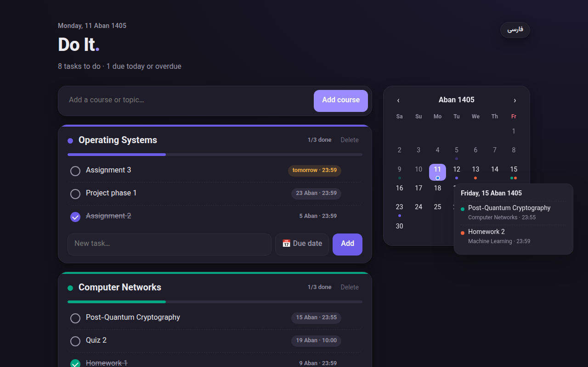

# Do It — Sharif

A simple to-do list for university courses, as a Chrome extension. It adds your **CW** (cw.sharif.ir) and **Quera** assignment deadlines automatically.

- Courses with tasks and due dates, picked from a Persian (Jalali) calendar
- Assignments from CW and Quera, with exact deadline times and links. The extension checks every hour, and submitted ones are ticked off automatically.
- A month calendar with a dot for every task. Hover over or tap a day to see what's due.
- Keeps syncing CW through your private calendar link if your CW login expires, and reminds you to log in again
- Persian and English interface, light and dark mode
- Everything stays on your computer: no server, no tracking, and it never sees your password ([privacy policy](store/privacy-policy.md))

## Install

1. Download the latest zip from [Releases](../../releases), or run `./build.sh` to make `dist/do-it-<version>.zip`.
2. Unzip it, open `chrome://extensions`, turn on **Developer mode**, and click **Load unpacked** on the unzipped folder.
3. Log in to cw.sharif.ir and quera.org in the same browser, then click the extension icon.

[راهنمای نصب به فارسی](store/INSTALL-fa.md)

## Files

| File | What it is |
|---|---|
| `index.html`, `app.js` | The app page (also works as a plain web page without the sync) |
| `background.js`, `sync.js` | Background service worker: hourly sync, CW/Quera fetching, alerts |
| `build.sh` | Packages the extension into a zip |
| `store/` | Store listing text, privacy policy, install guide, screenshots |
